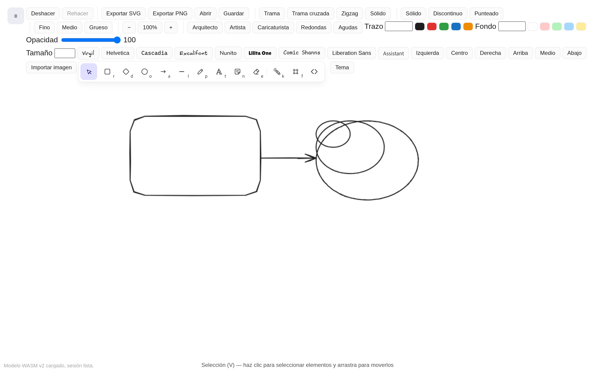
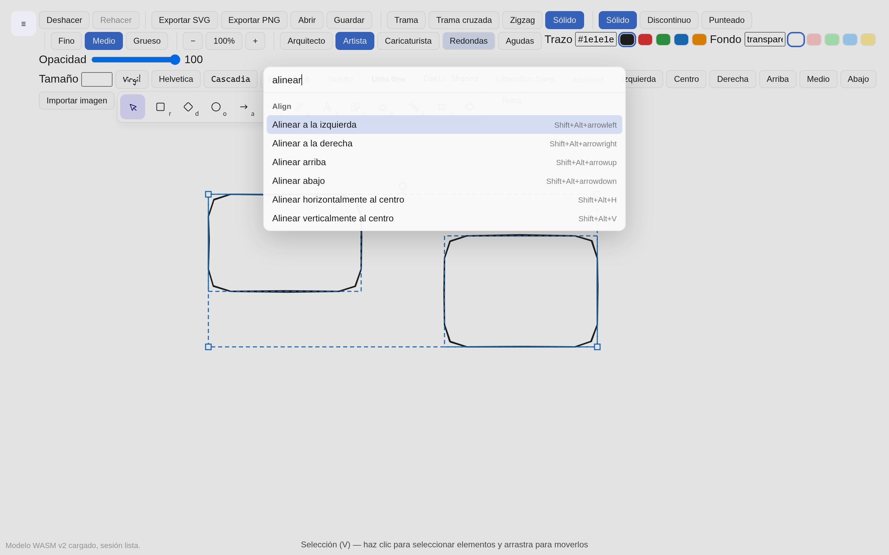
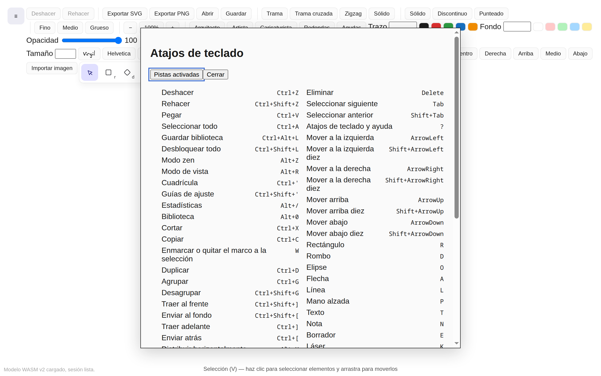

# Manual de NextDraw

NextDraw es un editor de diagramas local-first: el dibujo vive en tu navegador,
el documento es un fichero `.nextdraw` que puedes guardar, abrir y compartir, y
la aplicación no habla con ningún servidor que no sea el que la sirve y, si lo
abres, la sala colaborativa que tú elijas.

Este manual acompaña al artefacto publicado: describe lo que la versión que
tienes delante hace, no lo que una versión futura promete.

## Abrir, guardar y compartir

- **Abrir** un dibujo: el botón *Abrir* o el menú del lienzo (☰) → *Abrir*. Acepta
  ficheros `.nextdraw`, ficheros `.excalidraw` y PNG con la escena incrustada. Si
  el dibujo en pantalla tiene cambios sin guardar, se te pide confirmación antes de
  sustituirlo.
- **Guardar**: el botón *Guardar* descarga el documento actual como
  `nextdraw.nextdraw`. El fichero lleva dentro el mismo envelope que escribe
  Excalidraw (`type` y `version`), así que **se abre también en Excalidraw**; lo
  que cambia es el nombre del fichero. El guardado automático mantiene además una
  copia en el navegador: si cierras la pestaña, el dibujo sigue ahí la próxima vez.
- **Exportar**: *Exportar SVG* y *Exportar PNG* abren una hoja con resolución,
  fondo y margen; la exportación de una selección incluye sólo lo seleccionado.
- **Biblioteca**: *Guardar biblioteca* conserva los elementos elegidos como una
  pieza reutilizable; el panel *Biblioteca* las vuelve a poner en el lienzo y las
  intercambia como ficheros `.excalidrawlib`.
- Si un fichero llega reparado o con partes que esta versión no dibuja, la línea
  de estado lo dice y el documento se abre igual.

## Herramientas

Elige una herramienta con su tecla o con la barra; el lienzo te dice en la pista
inferior qué hace el siguiente gesto.

| Herramienta | Tecla | Qué hace |
|---|---|---|
| Selección | `V` o `M` | Elige elementos; arrastra para moverlos y usa los tiradores para redimensionar. |
| Rectángulo | `R` | Clic y arrastre. Con una forma ya elegida, la tecla sólo arma la herramienta. |
| Rombo | `D` | Clic y arrastre; igual que el rectángulo. |
| Elipse | `O` | Clic y arrastre. |
| Flecha | `A` | Clic y arrastre; al soltar el extremo cerca de una forma, queda atada a ella. |
| Línea | `L` | Clic y arrastre. Con varios clics seguidos dibuja una polilínea; `Enter` o `Escape` la cierra. |
| Mano alzada | `P` | Trazo libre, con la tinta que elijas. |
| Texto | `T` | Clic en el lienzo y escribe; `Escape` o `Ctrl+Enter` confirman, `Enter` es un salto de línea. |
| Nota | `N` | Clic y arrastre: una nota adhesiva con la fecha del día en el pie. |
| Borrador | `E` | Arrastra sobre lo que quieras borrar; `Alt` recupera lo marcado. |
| Láser | `K` | Señala sin dibujar: el rastro se desvanece. |
| Marco | `F` | Clic y arrastre: agrupa un área como marco con nombre. |
| Incrustar | — | Clic y arrastre: un marco que incrusta una página externa permitida por la política. |

## Estilos

La barra superior escribe sobre la selección entera y cada cambio es **un solo
paso de deshacer**. Cuando los elementos elegidos no coinciden, la fila lo dice
con `mixed` (`mixto` en español) y no enciende ninguna opción.

- **Trazo y fondo**: paleta y entrada hexadecimal para cada uno; `Sin color` deja
  el fondo transparente.
- **Relleno**: trama, trama cruzada, zigzag o sólido.
- **Grosor y opacidad**: fino, medio o grueso; opacidad de 0 a 100.
- **Esquinas**: redondeadas o agudas (sólo en las formas que las tienen).
- **Nivel de boceto**: arquitecto (líneas regladas), artista (el valor por
  defecto) y caricaturista (las esquinas se desvían).
- **Tipografía**: nueve familias (Virgil, Helvetica, Cascadia, Excalifont, Nunito,
  Lilita One, Comic Shanns, Liberation Sans y Assistant), tamaño, alineación
  horizontal y vertical, y auto-ajuste del ancho al contenido. Helvetica es la
  familia del sistema: si tu máquina la tiene, la usa; si no, el navegador elige
  su sans-serif.
- **Flechas**: punta de inicio y de fin (flecha, barra, círculo, punto, triángulo,
  rombo y las cardinalidades de un diagrama) y codo recto o redondeado.

## Selección y edición

- Clic para elegir, `Shift`+clic para añadir, arrastre en vacío para la marquesina,
  `Ctrl+A` para todo.
- **Mover**: arrastra o usa las flechas; `Shift`+flecha mueve de diez en diez.
- **Redimensionar**: tiradores de esquina y de lado. **Girar**: el tirador superior
  o `Shift+R` / `Ctrl+Shift+R` para cuartos de vuelta.
- **Alinear y distribuir**: alinea dos o más elementos a izquierda, derecha,
  arriba, abajo o centro; distribuye el espacio entre tres o más. El reparto es
  una sola operación deshacible.
- **Orden, grupos y bloqueo**: traer al frente, enviar al fondo, agrupar y
  desagrupar, bloquear y desbloquear.
- **Enmarcar** la selección con `W`; el marco se mueve con lo que contiene.
- **Enlaces**: `Ctrl+K` edita el enlace de un elemento; al pasar el puntero se
  muestra su dirección, con abrir en una pestaña nueva.
- **Cambiar de forma**: con rectángulos, rombos o elipses elegidos, `Tab` abre el
  selector de forma y cada `Tab` pasa a la siguiente (`Shift+Tab` a la anterior);
  cada cambio es un solo paso de deshacer.
- **Duplicar** con `Ctrl+D` y **borrar** con `Supr`; el borrado de la selección y
  el vaciado del lienzo son un solo paso de deshacer.

## La paleta de comandos

`Ctrl+Shift+P` abre la paleta. Escribe parte del nombre del comando —no hace
falta que sea exacto— y `Enter` ejecuta el primero. Sin coincidencias, la paleta
ofrece los comandos disponibles para que no te quedes sin salida.

## Atajos de teclado

La tabla siguiente se genera del propio registro de comandos: si un atajo cambia
en la aplicación, cambia aquí. El buscador de ayuda (`?`) muestra la misma lista
en la interfaz.

<!-- BEGIN shortcuts -->
| Acción | Atajo |
|---|---|
| Abrir | `Ctrl+O` |
| Acercar la vista | `Ctrl++` |
| Agrupar | `Ctrl+G` |
| Ajustar a la selección | `Shift+@` |
| Ajustar al contenido | `Shift+!` |
| Alejar la vista | `Ctrl+-` |
| Alinear a la derecha | `Ctrl+Shift+arrowright` |
| Alinear a la izquierda | `Ctrl+Shift+arrowleft` |
| Alinear abajo | `Ctrl+Shift+arrowdown` |
| Alinear arriba | `Ctrl+Shift+arrowup` |
| Atajos de teclado y ayuda | `?` |
| Aumentar el tamaño de letra | `Ctrl+Shift+>` |
| Biblioteca | `Alt+0` |
| Bloquear | `Ctrl+Shift+L` |
| Borrador | `E` |
| Cambiar tema | `Shift+Alt+D` |
| Cambiar tipo de forma | `Tab` |
| Cambiar tipo de forma hacia atrás | `Shift+Tab` |
| Copiar | `Ctrl+C` |
| Copiar como PNG | `Shift+Alt+C` |
| Copiar estilos | `Ctrl+Alt+C` |
| Cortar | `Ctrl+X` |
| Cuadrícula | `Ctrl+'` |
| Desagrupar | `Ctrl+Shift+G` |
| Desbloquear todo | `Ctrl+Shift+L` |
| Deshacer | `Ctrl+Z` |
| Disminuir el tamaño de letra | `Ctrl+Shift+<` |
| Distribuir horizontalmente | `Alt+H` |
| Distribuir verticalmente | `Alt+V` |
| Duplicar | `Ctrl+D` |
| Editar el texto seleccionado | `Enter` |
| Editar enlace | `Ctrl+K` |
| Eliminar | `Delete` |
| Elipse | `O` |
| Enmarcar o quitar el marco a la selección | `W` |
| Enviar al fondo | `Ctrl+Shift+[` |
| Enviar atrás | `Ctrl+[` |
| Escape | `Escape` |
| Estadísticas | `Alt+/` |
| Explorador accesible | `Alt+E` |
| Fijar herramienta | `Q` |
| Flecha | `A` |
| Girar 90° a la derecha | `Shift+R` |
| Girar 90° a la izquierda | `Ctrl+Shift+R` |
| Guardar biblioteca | `Ctrl+Alt+L` |
| Guías de ajuste | `Alt+S` |
| Insertar imagen | `9` |
| Láser | `K` |
| Línea | `L` |
| Mano | `H` |
| Mano alzada | `P` |
| Marco | `F` |
| Modo de vista | `Alt+R` |
| Modo zen | `Alt+Z` |
| Mostrar selector de color de fondo | `G` |
| Mostrar selector de color de trazo | `S` |
| Mostrar selector de fuentes | `Shift+F` |
| Mover a la derecha | `ArrowRight` |
| Mover a la derecha cinco | `Shift+ArrowRight` |
| Mover a la izquierda | `ArrowLeft` |
| Mover a la izquierda cinco | `Shift+ArrowLeft` |
| Mover abajo | `ArrowDown` |
| Mover abajo cinco | `Shift+ArrowDown` |
| Mover arriba | `ArrowUp` |
| Mover arriba cinco | `Shift+ArrowUp` |
| Nota | `N` |
| Pegar | `Ctrl+V` |
| Pegar como texto sin formato | `Ctrl+Shift+V` |
| Pegar estilos | `Ctrl+Alt+V` |
| Recorrer el diagrama a la derecha | `Alt+ArrowRight` |
| Recorrer el diagrama a la izquierda | `Alt+ArrowLeft` |
| Recorrer el diagrama abajo | `Alt+ArrowDown` |
| Recorrer el diagrama arriba | `Alt+ArrowUp` |
| Rectángulo | `R` |
| Rehacer | `Ctrl+Shift+Z` |
| Restablecer el zoom | `Ctrl+0` |
| Rombo | `D` |
| Selección | `V` |
| Selección | `M` |
| Seleccionar todo | `Ctrl+A` |
| Soltar la selección | `Ctrl+Shift+A` |
| Texto | `T` |
| Traer adelante | `Ctrl+]` |
| Traer al frente | `Ctrl+Shift+]` |
| Vaciar lienzo | `Ctrl+Delete` |
| Voltear horizontalmente | `Shift+H` |
| Voltear verticalmente | `Shift+V` |
<!-- END shortcuts -->

## La sala colaborativa

Un dibujo puede compartirse en una **sala** mediante un enlace: quien lo abre
edita el mismo documento en tiempo real. La sala se sirve desde un relevo
(relay) y el enlace lleva la clave de cifrado en el fragmento de la dirección —
la parte que el navegador no envía al servidor—, así que quien tiene el enlace
es quien puede leer el dibujo.

- Cada persona tiene un color derivado de su identidad y su puntero, su láser y
  su selección se ven con ese color.
- Si dos pestañas del mismo documento se pisan, la aplicación **para el guardado
  y pregunta**: conservar esta pestaña o adoptar la última versión. Nunca se
  sobrescribe en silencio.
- La presencia es efímera: no viaja al documento ni al historial.

## Sin conexión e instalación

La aplicación se instala como una aplicación web (PWA) desde el navegador
(menú → *Instalar*). Una vez cargada funciona sin red: el trabajador de servicio
guarda el documento, el artefacto y los módulos de la versión servida, y te
avisa cuando hay una versión nueva para recargar.

## Accesibilidad

- Toda la barra y los diálogos se recorren con `Tab`, y los controles se operan
  con `Enter` y `Espacio`.
- `?` abre la hoja de atajos; `Alt+/` abre las estadísticas del dibujo.
- El lector de pantalla anuncia las regiones y los controles en el idioma de la
  página (`?lang=es`, `?lang=ar` o el idioma del navegador).
- La pista inferior describe la herramienta activa y su siguiente gesto.

## Límites conocidos

- El texto se mide con la tabla de la fuente del editor; un tipo de letra del
  sistema (Helvetica) puede medir distinto en tu máquina.
- La colaboración no fusiona dos ediciones simultáneas del mismo campo: resuelve
  el conflicto por versión con tu elección explícita.
- La exportación SVG/PNG es la misma tinta que ves, no un segundo renderizador.

## La política de seguridad

La página se sirve con una Content-Security-Policy que decide qué puede cargar el
navegador. Su documento, [csp.md](csp.md), explica cada directiva y por qué está;
acompaña al artefacto publicado junto con este manual.
